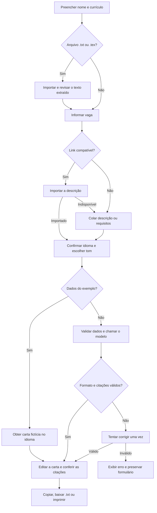

# Arquitetura

A interface e a API compartilham a origem HTTP. O navegador mantém as informações do formulário enquanto a página está aberta. O servidor valida cada entrada e processa as cartas em memória, com uma chamada de geração por vez.

## Fluxo da candidatura



## Componentes

| Componente | Responsabilidade |
| --- | --- |
| Frontend | Formulário, importações, revisão de trechos, edição e exportação |
| `LetterController` | Contratos HTTP, validação de tamanho e erros de entrada |
| `ResumeText` | Normalização de texto e extração básica de LaTeX sem compilação |
| `VacancyImport` | Leitura de HTML de provedores de vaga permitidos |
| `OllamaLetterWriter` | Chamada ao modelo, limite de concorrência e uma tentativa de correção |
| `Letter` | Formato por idioma, contagem de palavras e verificação das citações |
| `DemoLetters` | Validação e carregamento dos exemplos incluídos no JAR |

## API

| Método e caminho | Entrada | Saída |
| --- | --- | --- |
| GET `/api/settings` | | Flags de geração, código de acesso e modelo remoto |
| GET `/api/examples` | | Nome, currículo e descrição fictícios |
| GET `/api/examples/{language}` | `PT`, `EN` ou `ES` | Carta fictícia formatada |
| POST `/api/resume` | Multipart com `file` em UTF-8 | `{"text":"…"}` |
| POST `/api/vacancy` | JSON com `url` | `{"description":"…","truncated":false}` |
| POST `/api/letters` | JSON abaixo, com `X-Orbe-Access` se configurado | `{"text":"…","wordCount":280,"evidence":["…"],"example":false}` |
| GET `/actuator/health` | | Estado do processo HTTP |

```json
{
  "name": "Marina Costa",
  "resume": "Desenvolvi APIs em Java e Spring Boot para rastreamento de entregas.",
  "vacancy": "Engenharia de backend na Horizonte Logística. Requisitos: Java, Spring Boot e APIs REST.",
  "language": "EN",
  "tone": "PROFESSIONAL",
  "emphasis": "Rastreamento de entregas",
  "remoteConsent": false
}
```

A API retorna `400` para dados inválidos, `403` para código incorreto, `413` para arquivo acima do limite, `422` para link indisponível, `429` para geração concorrente, `502` para saída inválida do modelo, `503` para modelo indisponível ou desativado e `504` quando o modelo ultrapassa o prazo de resposta. A geração remota exige `remoteConsent: true`. As respostas com conteúdo pessoal usam `Cache-Control: no-store`. O indicador de saúde verifica o processo, independentemente de o modelo estar disponível.

A importação de vagas limita tamanho e espera, permite anfitriões HTTPS explícitos e não segue redirecionamentos. Currículo e descrição são enviados ao modelo como dados JSON, com instruções para ignorar comandos encontrados no conteúdo.
